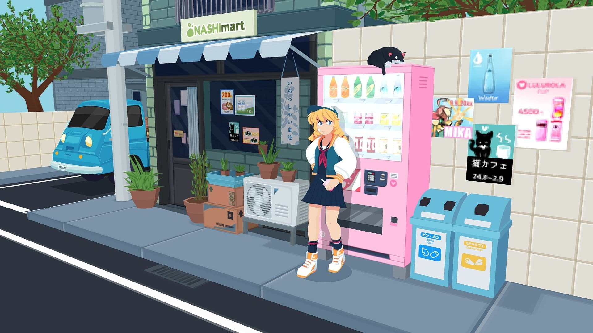

  

<h2 align="center">Hi, I'm Abdul Mannan Ali 👋</h2>

I’m a BSCS student and aspiring <b>Game Developer</b>. I’ve been working with C# for a few months and started making games in <b>Unity</b>, where I’ve built a few beginner projects. I’m currently working on C++ along with C# and plan to learn <b>Unreal Engine</b> in the future.

<table align="center">
  <tr>
    <td align="center">
      <h3>💻 Languages</h3>
      
    </td>
    <td align="center">
      <h3>🛠️ Tools</h3>
      
    </td>
  </tr>
  <tr>
    <td align="center" colspan="2">
      <h3>📦 Technologies</h3>
      
    </td>
  </tr>
</table>

  
  
  
  

